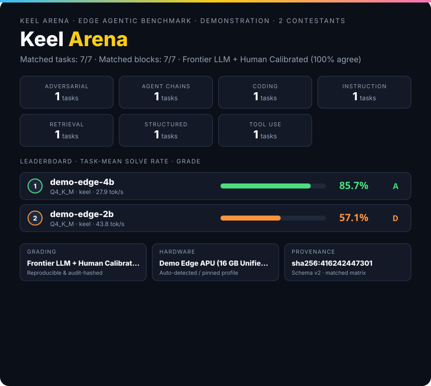
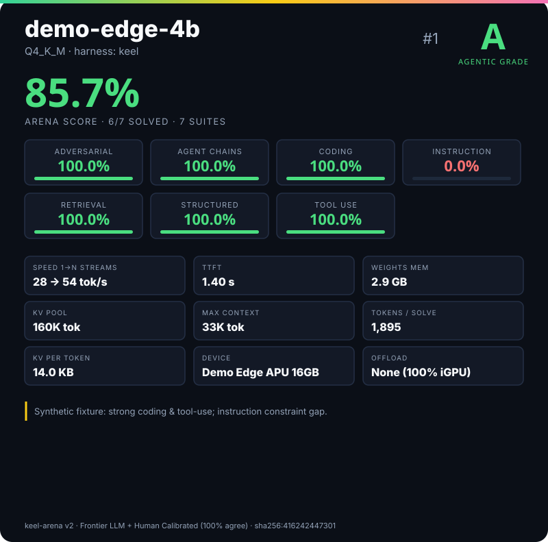

# Keel Arena

[](https://github.com/olivermikkola/keel-arena/actions/workflows/ci.yml)
[](LICENSE)


**Is your local model actually any good?** Keel Arena answers that on your own
hardware: same tasks, same rules, honest scores — no leaderboard hype.

**Edge AI & coding-agent benchmarking suite.** Compare local models, quantizations, and agent harnesses inside identical isolated environments with deterministic checks, **blinded Frontier LLM judging + human calibration**, hardware/throughput profiling, and shareable SVG scorecards.

**Public tooling. Private evaluations. Training stays downstream.**

<table>
<tr>
<td width="52%"></td>
<td width="48%"></td>
</tr>
</table>
<sub>Synthetic demonstration cards rendered from <code>examples/synthetic-gauntlet-results.json</code> (<code>purpose: "demonstration"</code>, not measured model results).</sub>

## First 60 seconds

Requires Python 3.11+ with **zero third-party dependencies** for validation, reporting, judging, hardware probing, and SVG/HTML cards (no containers, accounts, or API keys needed to try):

```sh
git clone https://github.com/olivermikkola/keel-arena.git && cd keel-arena

python3 -m keel_arena list-suites        # see 16 tasks including the two repair tasks
python3 -m keel_arena probe-edge         # auto-detect CPU, RAM, GPU/Vulkan/CUDA, thermals
python3 -m keel_arena validate examples/synthetic-gauntlet-results.json
python3 -m keel_arena report examples/synthetic-gauntlet-results.json --format markdown
python3 -m keel_arena cards examples/synthetic-gauntlet-results.json --out ./demo-cards
python3 -m keel_arena view examples/synthetic-gauntlet-results.json --out ./artifacts/demo-compare
python3 -m keel_arena compare-keel-mobile examples/synthetic-keel-mobile/base-run \
  --against examples/synthetic-keel-mobile/adapted-run --format markdown
python3 -m unittest discover -s tests -v && python3 scripts/check_publication.py
```

Optional local install adds the `keel-arena` executable (`python3 -m pip install .`, or `python3 -m pip install '.[harbor]'` for Python 3.12+ with Harbor 0.26.0 container studies).

## What it measures

| Capability | Details | Guide |
| --- | --- | --- |
| **7-suite Edge Agentic Gauntlet** | 16 curated Harbor-format tasks including two repair tasks. Suites cover `coding`, `tool-use`, `adversarial`, `agent-chains`, `structured`, `retrieval`, and `instruction` (`+ repair`) with separate offline verifiers | [edge-gauntlet.md](docs/edge-gauntlet.md) |
| **Frontier LLM Judge & Calibration** | Blinded rubric evaluation (`temp=0`, injection-contained), position-swapped pairwise **Elo**, and post-test human overrides with agreement & Cohen's κ | [frontier-judge.md](docs/frontier-judge.md) |
| **Edge Telemetry & Cards** | `1 → N` concurrent SSE stream throughput (`tok/s`), median/p95 TTFT, tokens-per-solve, hardware auto-detection, SVG scorecards, and offline HTML dashboard | [edge-gauntlet.md](docs/edge-gauntlet.md) |
| **Matched Matrix & `pass@k`** | Excludes infrastructure-failed `(task, repetition)` blocks across all contestants, separates timeouts from infra errors, equal task weights, combinatorial `pass@k` | [metrics.md](docs/metrics.md) |
| **Harbor 0.26.0 Isolation & ATIF** | Frozen studies with SHA-256 receipts, rotating order, thermal stops, bounded SSE proxy (`runtime.py`), and ATIF-v1.8 trace export | [studies.md](docs/studies.md) |
| **Keel Mobile Paired Comparison** | Compare saved `tools/harness-eval` per-attempt JSONL runs offline: changed tasks, budget/request timeouts, setup diffs, and speed-shift warnings | [keel-mobile.md](docs/keel-mobile.md) |

## Run a real study

Initialize a frozen `schema_version: 2` study in one command (auto-hashing your `keel` binary and optionally profiling local inference endpoints):

```sh
python3 -m keel_arena init-study \
  --suite gauntlet \
  --contestant qwen-4b=openai/qwen4-4b@http://127.0.0.1:8080/v1\|Q4_K_M\|keel \
  --contestant bonsai-9b=openai/bonsai-9b@http://127.0.0.1:8081/v1\|Q2_0\|keel \
  --probe-edge \
  --out "$PRIVATE_DIR/study.json"

HARBOR_TELEMETRY=0 python3 -m keel_arena freeze-study "$PRIVATE_DIR/study.json" --out "$PRIVATE_STUDY_DIR"
HARBOR_TELEMETRY=0 python3 -m keel_arena run-study "$PRIVATE_STUDY_DIR"
python3 -m keel_arena cards "$PRIVATE_STUDY_DIR/results.json" --out "$PRIVATE_STUDY_DIR/cards"
```

Start from `examples/study-template.json` if you prefer a hand-authored v1 matrix. Keep task banks, model manifests, raw traces, and study outputs **outside Git** (or inside ignored `private/`, `runs/`, and `artifacts/`). There is no automatic upload or public leaderboard.

## Where it fits

Arena is the proof layer of the [Keel family](https://github.com/olivermikkola/keel-code/blob/main/docs/VISION.md):
**Keel (CLI) is the coding agent, Keel Desktop is the everyday app whose Code
mode is the Keel CLI** — and Arena is how they earn their claims.

| Project | Responsibility |
| --- | --- |
| [Keel Code](https://github.com/olivermikkola/keel-code) | CLI + TUI coding-agent harness (`keel`) for small local models |
| [Keel Desktop](https://github.com/olivermikkola/keel-desktop) | Everyday local-AI app (Chat, Work, Images, Code) |
| [Keel Mobile](https://moesystems.com/keel-mobile/) / [Keel Console](https://github.com/olivermikkola/keel-xbox) | On-device iPhone agent / living-room Xbox app |
| [Keel Mobile for Android](https://github.com/olivermikkola/keel-mobile-android) | On-device Android agent, source-build pre-alpha |
| **Keel Arena** (this repo) | Evaluation protocol, 7-suite gauntlet, frontier LLM judge, hardware profiling, and scorecards |
| `llm-lab` (or downstream consumer) | Training-data selection, SFT/DPO experiments, and model weights |

## Documentation

- [Edge Gauntlet & Hardware Profiling](docs/edge-gauntlet.md) · [Frontier LLM Judge & Human Calibration](docs/frontier-judge.md)
- [Frozen Studies](docs/studies.md) · [Harbor Keel Adapter](docs/keel-agent.md) · [Import Harbor Trials](docs/harbor-import.md) · [Compare Saved Keel Mobile Runs](docs/keel-mobile.md)
- [Task-Level Metrics & `pass@k`](docs/metrics.md) · [Result Contract](docs/results-v1.md) · [ATIF Trajectories](docs/trajectories.md)
- [Offline Compare Viewer](docs/compare-viewer.md) · [Original Repair Pack](docs/task-pack.md) · [Downstream Training Boundary](docs/downstream.md) · [Competitive Research](docs/competitive-research.md) · [Roadmap](docs/execution.md)

## Contribute

MIT licensed. See [CONTRIBUTING.md](CONTRIBUTING.md) and [AGENTS.md](AGENTS.md). Every commit and PR is public; run `python3 scripts/check_publication.py` before pushing.
